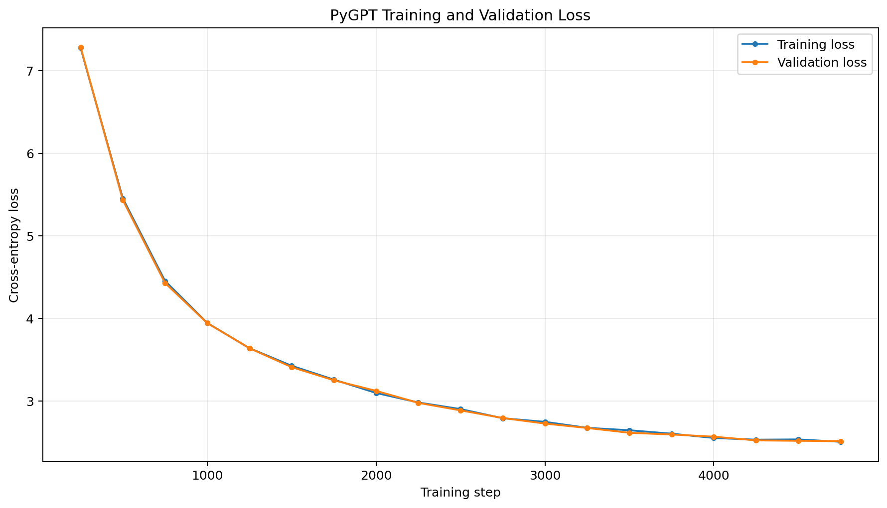

# PyGPT --- A Small GPT-Style Model for Python Code Generation

PyGPT is an experimental small language model (SLM) built with PyTorch
to explore the end-to-end workflow behind decoder-only Transformers:
dataset preparation, tokenization, model implementation, pre-training,
validation, checkpointing, and autoregressive code generation.

> **Project status:** Research / learning project. Generated code is
> experimental and must be reviewed and tested before use.

## Highlights

-   Custom decoder-only GPT-style Transformer implemented in PyTorch
-   Code-oriented training data from
    [`nampdn-ai/tiny-codes`](https://huggingface.co/datasets/nampdn-ai/tiny-codes)
-   StarCoder tokenizer with a vocabulary configured from the tokenizer
-   Rotary Positional Embeddings (RoPE) and causal self-attention
-   AdamW optimization, learning-rate warmup and cosine decay
-   Gradient accumulation, gradient clipping, and mixed-precision
    support
-   Train/validation loss tracking and best-validation-checkpoint saving
-   Autoregressive generation with temperature and top-k sampling

## Model architecture

  Component                       Configuration
  ------------------------------- ---------------------------------------------------
  Architecture                    Decoder-only GPT-style Transformer
  Transformer blocks              8
  Attention heads                 8
  Embedding dimension             512
  Context window                  512 tokens
  Dropout                         0.1
  Attention positional encoding   Rotary Positional Embeddings (RoPE)
  Normalization                   Layer normalization
  Feed-forward hidden dimension   4 × embedding dimension
  Vocabulary                      StarCoder tokenizer vocabulary (`len(tokenizer)`)
  Input/output embeddings         Tied weights
  Objective                       Next-token prediction with cross-entropy loss

The architecture values above are taken from the notebook configuration.
Parameter count is intentionally not stated here; run the
parameter-count snippet below in the notebook to calculate it from the
instantiated model.

## Dataset and preprocessing

The notebook loads the `train` split of `nampdn-ai/tiny-codes` and
creates a train/validation split using `test_size=0.05` and `seed=42`.
The notebook then tokenizes and prepares token data for training.

-   Training split: 95%
-   Validation split: 5%
-   Split seed: 42
-   Tokenizer: StarCoder tokenizer (as configured in the notebook)

Dataset availability, licensing, and the suitability of its contents
should be checked before redistribution or commercial use. The
repository does not include the dataset itself.

## Training configuration

  Setting                                               Value
  ------------------------------------- ---------------------
  Maximum training iterations                           5,000
  Initial learning rate                                0.0003
  Minimum learning rate                               0.00003
  Warmup steps                                            500
  Evaluation interval                               250 steps
  Batch size                                               16
  Sequence length                                  512 tokens
  Gradient accumulation steps                               4
  Optimizer                                             AdamW
  Weight decay                                            0.1
  Gradient clipping                                       1.0
  Random seed                                              42
  Compute target in notebook metadata     Google Colab T4 GPU

Actual runtime, memory usage, and hardware availability will vary. The
notebook uses CUDA when available and includes mixed-precision logic;
CPU execution may be significantly slower.

## Training results

The notebook's recorded training output reports the following values:

     Step   Training loss   Validation loss
  ------- --------------- -----------------
      250          7.2755            7.2824
    1,000          3.9452            3.9429
    2,000          3.0966            3.1218
    3,000          2.7467            2.7260
    4,000          2.5517            2.5670
    4,750          2.5056            2.5138



**Interpretation:** Both training and validation loss decrease
substantially in the recorded run, suggesting the model is learning
patterns in the training distribution. The similar values are
encouraging, but loss alone does not establish code correctness,
functional accuracy, or generalization to unseen programming tasks. The
notebook logs evaluations through step 4,750; do not describe this as a
fully evaluated 5,000-step result unless you run and record that final
evaluation.

## Quick start

### Option A --- Run in Google Colab

1.  Open [`PyGPT.ipynb`](PyGPT.ipynb) in GitHub.
2.  Select **Open in Colab** (or upload the notebook to Google Colab).
3.  Choose a GPU runtime if available.
4.  Run the notebook cells in order.
5.  If prompted for Hugging Face authentication, add your token through
    Colab Secrets using the key expected by the notebook (`HF_TOKEN`).
6.  Allow the dataset to download and preprocessing to finish before
    starting training.

### Option B --- Local environment

The notebook is written around Google Colab utilities and a GPU-oriented
training setup. For local execution, install the dependencies and
adapt/remove Colab-specific imports and secret handling first.

``` bash
pip install torch transformers datasets tqdm matplotlib numpy
```

A CUDA-capable GPU is recommended for practical training speed. Check
the notebook for any additional dependencies before running it locally.

## Generate code

The notebook demonstrates generation from a Python function prompt using
the saved best checkpoint. Its generation method supports temperature
and top-k sampling. A lower temperature generally makes sampling more
conservative; top-k restricts sampling to the highest-scoring candidate
tokens.

Example prompt used in the notebook:

``` python
def is_palindrome(s):
    """Check if string is palindrome"""
```

The model may produce syntactically invalid, logically incorrect,
repetitive, or unrelated output. Always inspect and test generated code
in a sandbox.

## Check parameter count

Run this after constructing the model:

``` python
total_params = sum(p.numel() for p in model.parameters())
trainable_params = sum(p.numel() for p in model.parameters() if p.requires_grad)

print(f"Total parameters: {total_params:,}")
print(f"Trainable parameters: {trainable_params:,}")
print(f"Total parameters (millions): {total_params / 1_000_000:.2f}M")
```

## Repository structure

``` text
codeslm/
├── PyGPT.ipynb          # Dataset preparation, model, training, and generation
├── README.md            # Project overview and reproducibility notes
└── loss_curve.png   # Recorded training/validation loss plot
```

The loss plot is generated from the values recorded in the notebook
output. To reproduce it from a fresh run, save the actual step,
training-loss, and validation-loss values produced by your training
loop.

## Current limitations

-   This is an experimental model, not a production-ready coding
    assistant.
-   Code quality has not been established with a formal benchmark suite.
-   Training results depend on the dataset, runtime, random seed, and
    configuration.
-   The notebook is primarily Colab-oriented; local setup needs small
    adaptations.
-   No inference latency, throughput, memory, or cost benchmarks are
    reported yet.
-   The training log shown in the notebook does not include a final
    evaluation at step 5,000.

## Useful next steps

-   Add a reproducible evaluation set and report pass@1 or unit-test
    pass rate.
-   Save a generation sample that has been manually reviewed and tested.
-   Record the exact tokenizer/model versions and dataset revision.
-   Add a parameter count, training duration, peak GPU memory, and
    tokens-per-second measurement.
-   Export the loss history to CSV and save plots from each run.
-   Add checkpoint/resume support and a clean inference script.
-   Review dataset licensing before publishing model weights or using
    the model commercially.

## Acknowledgements

Built as a hands-on exploration of small language models, Transformer
architecture, and code generation using PyTorch and the Hugging Face
ecosystem.
